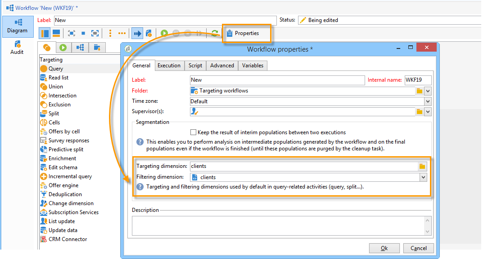

# 管理工作流程{#managing-workflows}

依預設，您的新工作流程是以預先設定的工作流程範本為基礎，並以收件者表格(nms:recipient)為基礎。 若要讓收件者自動以&#x200B;**Nms_DefaultRcpSchema**&#x200B;選項中參考的收件者自訂表格為基礎（請參閱[設定介面](../../configuration/using/configuring-the-interface.md)區段），您必須建立新的工作流程範本。

透過&#x200B;**[!UICONTROL Resources > Templates > Workflow templates]**&#x200B;節點建立新範本。 在範本的屬性中，提供的維度符合外部收件者表格。

透過將您的新工作流程建立在最近建立的範本上，依照預設，將會針對工作流程的全域目標定位和篩選維度選取您的個人化表格。

因此，工作流程中使用的所有活動都會使用自訂表格，不需要任何其他手動設定。

如需此工作流程的詳細資訊，請參閱[本小節](../../workflow/using/about-workflows.md)。

