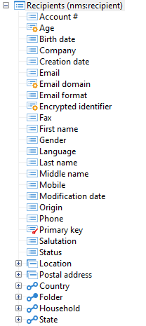

# 資料方案結構{#structure-of-a-data-schema}

資料結構描述的結構會以樹狀結構的形式顯示。 若要在Adobe Campaign使用者端主控台中以圖形方式檢視它，請選取目標結構描述，然後按一下「**[!UICONTROL Structure]**」子索引標籤。

作為標準，首先顯示欄位（「進行中」、「已啟動」等） 和的字母順序。 結構化元素排在後面（郵寄地址、位置），最後是連結（電子郵件資訊、資料夾等）。

主索引鍵以紅色索引鍵識別，而外來索引鍵以黃色索引鍵識別。

根據連結是否屬於表格，以圖形方式加以區分。 從表格開始的那些專案（即表格中有外部索引鍵）會先顯示（電子郵件資訊、資料夾、國家/地區）。 「反向」集合連結（訂閱、訂單等） 都會顯示在末端。
