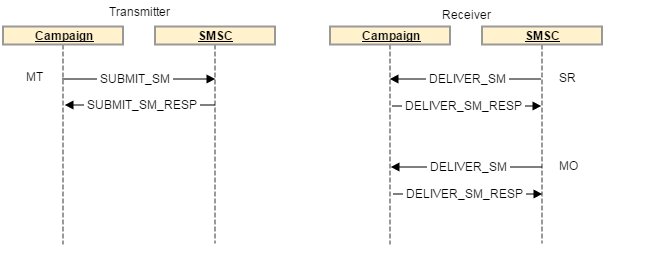

# 簡訊連接器通訊協定及設定 {#sms-connector-protocol}

>[!NOTE]
>
>透過此檔案，所有參考通訊協定、欄位名稱和值詳細資訊的參考均參考[SMPP 3.4規格](https://smpp.org/SMPP_v3_4_Issue1_2.pdf)。
>

作為從Campaign v7轉變到v8的一部分，Campaign Classic檔案集已簡化並重新組織。 Campaign v8檔案集中現在提供常見功能。 若要深入瞭解SMS聯結器設定，請參閱[Campaign v8檔案](https://experienceleague.adobe.com/en/docs/campaign/campaign-v8/send/sms/config-sms/smpp-external-account){target=_blank}。

[](https://experienceleague.adobe.com/en/docs/campaign/campaign-v8/send/sms/config-sms/smpp-external-account){target=_blank}

## 概觀 {#overview}

SMS可能僅限於傳送無格式的短文字訊息，但其簡易性使其成為有價值的通訊頻道。

傳送SMS有兩個主要方法：

* 手動透過電話傳送，這是人們直接溝通的常見方式。
* 透過Adobe Campaign傳送訊息的方式，從網際網路傳送。 為此，您需要將網際網路連線至行動網路的SMS服務提供者。
Adobe Campaign使用SMPP通訊協定傳送SMS給服務提供者。

本檔案將引導您完成Adobe Campaign與SMPP提供者之間的連線設定。

SMPP提供者有時可能會偏離官方規格，但Adobe Campaign中的SMS聯結器提供許多選項來調整其行為，使其與大多數提供者相容。

>[!IMPORTANT]
>
>設定與新提供者的連線可能需要一些技術技能、TCP知識、二進位、十六進位表示和文字編碼。 它還需要與提供者進行積極的合作。

## smpp通訊協定 {#smpp-protocol}

Adobe Campaign Classic支援SMPP通訊協定版本3.4。 這是廣泛的通訊協定，允許傳送SMS給提供者(SMSC)並接收SMS以及回條。 如需詳細資訊，請參閱[SMPP檔案](https://smpp.org/SMPP_v3_4_Issue1_2.pdf)。

SMS服務提供者端的網路裝置通常稱為SMSC。

### smpp連線 {#smpp-connections}

Adobe Campaign透過TCP連線至SMS服務提供者的網路裝置。 SMPP通訊協定會設定從Adobe Campaign到提供者的永久TCP連線。 TCP連線一律由Adobe Campaign起始，即使是接收訊息亦然。
SMPP會根據其模式開啟1或2個TCP連線。 所有連線一律由Adobe Campaign起始。

SMPP通訊協定可以在兩種模式中運作：

* **傳送器+接收器（或TX+RX）**：使用兩個獨立的TCP連線來傳送及接收訊息。
* **收發器（或TRX）**：單一TCP連線用於傳送及接收訊息。

>[!NOTE]
>
> Adobe Campaign Classic僅支援TX+RX模式。 這項限制源於其技術架構。

### SMPP PDU {#smpp-pdu}

SMPP傳輸單位（「封包」）稱為PDU。 **PDU**&#x200B;包含命令、狀態、序號和資料。

每個PDU都必須由`SMPP RESP PDU`確認（同步回應）。 請求可以管道化：傳送者可以傳送許多命令，而不需要等候`RESP`，任何時候可以管道化的請求數稱為視窗。 `RESP PDU`可能以任何順序到達，與其對應的啟動器PDU的順序無關。

在分隔的&#x200B;**傳送器+接收器**&#x200B;模式中，使用的連線取決於傳送的訊息型別。 傳送器連線用於MT，而接收器連線用於MO和SR。 各種訊息的要求和回應會透過相同的TCP連線傳送。

例如，傳送MT時，會使用傳送器連線，而且會透過傳送器通道傳送確認MT的`RESP`。 當您收到MO （或SR）時，接收器連線會用來接收MO並傳送確認MO的`RESP`。



在Adobe Campaign Classic中，若要將SR與其對應的MT連結，SMSC會傳回包含`SUBMIT_SM_RESP`和`DELIVER_SM`步驟的ID。 識別碼儲存在`nms::providerMsgId`資料表的`providerId`欄位中，並連結至`broadLogId`和`deliveryId`。 此比對操作由SMS程式在寫入資料庫時完成。

成功的`SUBMIT_SM_RESP PDU`會在傳送記錄中觸發「已傳送」訊息狀態，而成功的`DELIVER_SM (SR) PDU`則會觸發「已接收」訊息狀態。

### 安全性方面 {#security-aspects}

通訊協定本身並未加密。 大部分提供者在允許清單上實作IP的變體，因此必須向提供者宣告Adobe Campaign伺服器IP位址。

Adobe Campaign支援在繫結階段傳遞登入和密碼。 它也支援SMPP over TLS。 請注意，需要憑證才能保證適當的安全性。 雖然SMPP聯結器允許略過憑證檢查，但只應該用於測試，因為沒有憑證的TLS提供顯著較低的安全性層級。

聯結器使用系統`openssl`程式庫提供的預設憑證。 通常由Debian上的`/etc/ssl/certs`目錄提供。 此目錄預設由「ca-certificates」套件提供，但可加以自訂。

### 各種PDU中的資訊 {#information-pdu}

每種PDU都有不同的欄位，這些欄位包含不同的資訊。 這些PDU在[SMPP 3.4規格](https://smpp.org/SMPP_v3_4_Issue1_2.pdf)中有詳細說明。

以下各節說明PDU及其同步回應(`*_RESP PDU`)。 所有PDU都必須由對應的`RESP`確認，這是規格的必要部分。

PDU可以有選填欄位。 此處僅說明最常見的欄位。 如需詳細資訊，請參閱[SMPP 3.4規格](https://smpp.org/SMPP_v3_4_Issue1_2.pdf)。

**BIND_TRANSMITTER / BIND_RECEIVER / BIND_TRANSCEIVER**

此PDU用於啟動與SMSC的連線。 **傳送器**、**接收器**&#x200B;和&#x200B;**收發器**&#x200B;模式只會變更允許透過此連線傳送的SMS型別，特別是：

| 模式 | 允許的SMS型別 |
|:-:|:-:|
| 傳送器 | MT |
| 接收者 | MO + SR |
| 收發器 | MT + MO + SR |

`BIND_* PDU`中的主要欄位：

* **system_id**：用於驗證的登入。 在外部帳戶中設定。

* **密碼**：用於驗證的密碼。 在外部帳戶中設定。

* **system_type**：某些提供者必須設定為特定值。 在外部帳戶中設定，適用於所有版本。 經常會區分不同型別的合約、管道、國家/地區等。

* **addr_ton**&#x200B;和&#x200B;**addr_npi**：某些提供者必須使用。 由外部帳戶中的`Bind TON`和`Bind NPI`設定所設定。

* **address_range**：某些提供者需要此專案。 大部分時間，此連線都允許使用短程式碼清單。 在外部帳戶中設定。

`BIND_*_RESP`沒有特定欄位，它確認連線是否成功。

#### 解除繫結 {#unbind}

此PDU必須在中斷連線之前由系統傳送。 它必須等候相符的`UNBIND_RESP` PDU才能關閉連線。

符合SMSC的請勿關閉連線，TCP連線是由Adobe Campaign聯結器所控制。

#### SUBMIT_SM {#submit-sm}

此PDU會將MT傳送至SMSC。 其回應PDU會提供MT的ID。

`SUBMIT_SM` PDU中的主要欄位：

* **service_type**：某些提供者需要。 在傳遞屬性中設定。

* **source_addr_ton**&#x200B;和&#x200B;**source_addr_npi**：指示要傳輸哪種來源位址。 這些欄位的含義是標準化的，但由於某些提供者使用欄位的方式不同，因此您應要求提供者提供其正確的值。 在外部帳戶中設定。

* **source_addr**： MT的來源位址/ oADC。 它將顯示在行動電話上。 在外部帳戶和傳送中設定，傳送中的值優先於外部帳戶的值。

* **dest_addr_ton**&#x200B;和&#x200B;**dest_addr_npi**：指出要傳輸的目標位址型別（例如本機或國際格式）。 這些欄位的含義是標準化的，但由於某些提供者使用欄位的方式不同，因此您應要求提供者提供其正確的值。 在外部帳戶中設定。

* **destination_addr**：收件者地址、電話號碼或MSISDN。

* **esm_class**：用來判斷文字欄位中是否使用了UDH。 若未使用`message_payload`模式，聯結器會自動啟用分割SMS。

* **priority_flag**：此郵件的優先順序高於其他郵件。 這會與傳遞本身的優先順序緊密結合。

* **validity_period**：時間戳記，之後不應再嘗試重試。 在傳遞本身中設定。

* **registered_delivery**：告知是否要求SR。 Adobe Campaign一律會設定此標幟，自動回覆除外。 對於多部分訊息，僅針對第一部分設定標籤。 所有版本都有相同的行為。

* **data_coding**：表示文字欄位中使用的編碼。 如需詳細資訊，請參閱[SMS文字編碼](https://experienceleague.adobe.com/en/docs/campaign/campaign-v8/send/sms/sms-channel#sms-text-encoding){target="_blank"} （Campaign v8檔案）一節。

* **short_message**：訊息的文字。 若使用UDH，這也會包含UHD標頭。

Adobe Campaign支援下列選用欄位：

* **dest_addr_subunit**：用於指定SMS的目標：快閃、行動或SIM卡。 在傳遞屬性中設定。

* **message_payload**：在外部帳戶中啟用時，長訊息將在單一PDU中傳送，文字將在此欄位中傳輸，而不是`short_message`欄位。

#### SUBMIT_SM_RESP {#submit-sm-resp}

此PDU將包含MT的ID。 這對於將其與傳入SR匹配很有用。

>[!IMPORTANT]
>
>許多提供者會以十六進位傳送MT ID。 請確定您已在外部帳戶中正確設定MT確認中的&#x200B;**ID格式**。

有些提供者在傳送SR後會傳送`SUBMIT_SM_RESP`。 為了說明該行為，Adobe Campaign會等待30秒才回覆&#x200B;**無效的訊息ID**&#x200B;給具有未知ID的SR。

#### DELIVER_SM {#delivery-sm}

此PDU由SMSC傳送至Adobe Campaign。 它包含MO或SR。

大部分欄位與其`SUBMIT_SM`對應欄位具有相同的意義。 以下是實用欄位清單：

* **source_addr**： MO/SR的來源位址。 這通常是電話號碼。

* **destination_addr**：接收MO或SR的簡短代碼。

* **esm_class**：用於判斷PDU是MO還是SR。

* **short_message**：訊息的文字。 對於SR，這包含SMPP通訊協定規格附錄B中說明的資料。 如需詳細資訊，請參閱[SR錯誤管理](sms-protocol.md#sr-error-management)。

Adobe Campaign可使用某些設定讀取`receipted_message_id`選用欄位中的訊息ID。

#### DELIVER_SM_RESP {#deliver-sm-resp}

此PDU由Adobe Campaign傳送以認可SR和MO。

SR和MO插入資料庫後，Adobe Campaign Classic會加以確認。 即使已傳送成功的`DELIVER_SM_RESP` PDU，仍可能發生一些處理錯誤。 此限制是由Adobe Campaign Classic的軟體架構所造成。

#### ENQUIRE_LINK {#enquire-links}

此PDU僅用於檢查連線是否使用中。 應根據提供者的需求設定其頻率。

預設的60秒應與外部帳戶中設定的大多數設定相符。

#### INQUIRE_LINK_RESP {#enquire-links-resp}

此PDU確認連線為作用中。

### 多部分SMS （長SMS） {#multipart}

>[!IMPORTANT]
>
> Adobe Campaign僅支援傳送多部分SMS或長SMS。 傳入的SMS (MO)不支援UDH和`message_payload`，這表示MO限製為160個字元。

### 輸送量上限與視窗 {#throughput-capping}

大多數提供者需要每個SMPP連線的輸送量限制。 這可透過在外部帳戶中設定多個SMS來達成。 請注意，每個連線都會發生輸送量節流，總有效輸送量是每個連線的限制乘以連線總數。 這在[同時連線](sms-protocol.md#connection-settings)區段中詳細說明。

若要達到最大可能的輸送量，您需要微調最大傳送時段。 傳送視窗是不需要等候`SUBMIT_SM_RESP`即可傳送的`SUBMIT_SM PDU`數目。 如需詳細資訊，請參閱[傳送視窗設定](https://experienceleague.adobe.com/en/docs/campaign/campaign-v8/send/sms/config-sms/smpp-external-account#smpp-delays){target="_blank"} （Campaign v8檔案）一節。

### 服務請求與錯誤管理（「附錄B」） {#sr-error-management}

SMPP通訊協定定義了`RESP PDU`中的標準同步錯誤，但並未定義SR的錯誤代碼。 每個提供者都使用自己的錯誤代碼及其含義。

已在[SMPP通訊協定規格](https://smpp.org/SMPP_v3_4_Issue1_2.pdf) （第167頁）的附錄B區段中提供建議，但這不會列出實際的錯誤碼及其含義。

為了適應錯誤管理，已運用Adobe Campaign的broadlog訊息系統來適當地布建錯誤及其嚴重性（硬式、軟式等）。

如上所述，有兩種不同型別的錯誤：

* 在`SUBMIT_SM_RESP`中同步回覆，會在郵件傳送至SMSC後立即發生
* 行動裝置收到訊息或訊息逾時時，稍後可能會收到回條。 在這種情況下，錯誤可在SR中找到。

收到SR時，可在其`short_message`欄位中找到狀態和錯誤（例如附錄B合規實作）。 PDU的`short_message`欄位通常稱為&#x200B;**文字欄位**，因為它包含MT中的文字。 若是SR，則包含技術資訊以及名為&#x200B;**Text**&#x200B;的子欄位。 這2個欄位不同，`short_message`實際包含&#x200B;**文字**&#x200B;欄位和其他資訊。

Adobe Campaign Classic聯結器（擴充式SMPP除外）會根據選取的提供者，使用硬式編碼行為。 通用SMPP只會區分成功和錯誤，沒有詳細資料。 傳送記錄檔可能包含無法保證的一些資訊。

#### SR文字欄位格式 {#sr-text-field-format}

該規格建議對SR文字欄位使用此格式。 這是子欄位的清單，以冒號分隔以區隔欄位名稱及其值。 欄位名稱不區分大小寫。

符合附錄B建議的SR文字欄位範例：

```
id:1234567890 sub:001 dlvrd:001 submit date:1608011415 done date:1608011417 stat:DELIVRD err:000 Text:Hello Adobe world
```

ID欄位是`SUBMIT_SM_RESP PDU`中收到的ID，MT的認可。

`sub`和`dlvrd`應該計算傳遞的部分和傳遞的訊息數量，但Adobe Campaign並未使用此專案，因為broadlog系統提供更好、更整合的資訊。

`submit date`和`done date`欄位是指示性時間戳記，表示傳送MT的時間以及行動裝置傳送SR的時間。 預期時區會出現一些問題，甚至是日期集不正確的行動裝置所給定的錯誤時間戳記。

stat欄位很重要，因為它可告知訊息的狀態。 唯一重要的狀態為`DELIVRD`、`UNDELIV`和`REJECTD`。 `DELIVRD`狀態表示成功，其他兩個狀態表示錯誤。 也可以使用其他值，但通常是中繼通知，例如MT到達行動電信業者，但不是行動電話。 Adobe Campaign會忽略這些中繼通知。

錯誤欄位包含提供者特有的錯誤代碼。 提供者必須提供一份可能的錯誤代碼表格，以及能夠解譯此值的意義。

最後，文字欄位通常包含MT文字的開頭。 Adobe Campaign會忽略此專案，而有些提供者不會傳輸此專案，以避免PII洩漏和網路頻寬消耗。 在疑難排解期間，可透過讀取此欄位，更輕鬆地找出與測試MT相符的SR。

### Adobe Campaign Classic Extended generic SMPP中的SR處理範例 {#sr-processing}

此範例顯示遵循附錄B建議的實作案例、外部帳戶中的預設值以及成功的SMS MT。

```
id:1234567890 sub:001 dlvrd:001 submit date:1608011415 done date:1608011417 stat:DELIVRD err:000 Text:Hello Adobe world
```

首先，套用`id extraction`規則運算式以擷取ID並將其與對應的MT調解。

接著，`status extraction`規則運算式和`error code extraction`規則運算式會套用以擷取這些欄位，並附加至字串。

broadlog訊息是以此資訊建構，並且會附加原始未變更的字串以供參考：

```
SR ExampleProvider DELIVRD 000|MESSAGE=id:1234567890 sub:001 dlvrd:001 submit date:1608011415 done date:1608011417 stat:DELIVRD err:000 Text:Hello Adobe world
```

然後會標準化訊息，移除MESSAGE部分，以便能夠將多個訊息與相同的狀態和錯誤碼進行比對。

```
SR ExampleProvider DELIVRD 000|#MESSAGE#
```

如果訊息尚未布建在broadlog訊息表格中，則會建立新專案，將整個訊息用作&#x200B;**firstText**&#x200B;和規範化的訊息。 然後，聯結器使用成功和`error`規則運算式來判斷它是成功還是失敗：

* 如果它符合`success`規則運算式，則會視為成功。

* 如果符合`error`規則運算式，則訊息會限定為錯誤。

* 如果這兩個規則運算式都不相符，則會忽略SR。 它可能是中繼通知，Adobe Campaign不會處理。

依預設，所有錯誤都會布建為軟錯誤。 這表示必須手動布建硬錯誤。

## SMPP外部帳戶引數 {#SMPP-parameters-external}

SMPP通訊協定的每個實作都有許多變數。 為了改善相容性和適應性，可使用許多設定來變更SMPP聯結器的行為。 本節說明每個引數及其對聯結器的影響。

### 一般引數和路由 {#general-parameters-routing}

**限制此帳戶的MTA執行個體**

您可以設定允許連線至SMPP提供者的MTA執行個體數目限制。 如果勾選，您可以指定最多可以使用多少MTA。

這個選項可讓您更精確地控制連線數目，請參閱[同時連線](sms-protocol.md#connection-settings)。

如果您設定的值高於正在執行的MTA數量，則所有MTA都會正常執行：此選項只是一個限制，不會產生額外的MTA。

如果您需要精確控制連線數量（例如提供者需求），建議一律設定此選項，即使目前部署執行中的MTA數量正確。 如果之後新增其他MTA，仍會遵守連線限制。

### 連線設定 {#connection-settings}

#### SMSC 實作名稱 {#smsc-implementation-name}

設定SMSC實作的名稱。 應將其設定為您的提供者的名稱。 請聯絡管理員或傳遞團隊，以瞭解要在此欄位中新增什麼。 此欄位的角色在[SR錯誤管理](sms-protocol.md#sr-error-management)區段中說明。

>[!NOTE]
>
>傳遞能力團隊的參與是以合約為基礎，客戶應聯絡其Adobe代表，瞭解與傳遞能力參與相關的資訊。

#### MTA 子連線的數量 {#number-mta-child}

在Adobe Campaign Classic中，這會定義每個MTA子項的連線數目。

Adobe Campaign Classic Extended SMPP聯結器可控制每個MTA子項的連線數量。 若要控制連線的全域限制，您必須限制MTA子流程的數量，這通常表示要為SMS提供專用的中間來源平台。

Adobe Campaign Classic的接收器與傳送器連線數量可能有所不同：

* **傳送器連線= MTA子連線數* MTA子處理序數* MTA數（如果已設定自動回覆） * MTA子連線數**

如上所述，如果啟用自動回覆，Adobe Campaign Classic簡訊程式會開啟更多傳送器連線。 這些額外的連線可用來傳送自動回覆。

* **接收者連線= MTA子連線的數目**

如果您設定自動回覆，簡訊程式會開啟傳送器/接收器配對，增加傳送器連線的數量。 如果您未設定任何自動回覆，則僅會開啟接收器連線。

#### 透過 SMPP 啟用 TLS {#enable-TLS}

使用TLS連線到提供者。 連線將會加密。 TLS連線由OpenSSL程式庫管理，任何適用於OpenSSL的內容對於此連線都將為True。

#### 在記錄檔中啟用詳細的 SMPP 追蹤 {#enable-verbose-log-file}

此設定會傾印記錄檔中的所有SMPP流量。 在初始設定期間，通常需要調整引數。 疑難排解聯結器時，必須啟用此功能，並與提供者看到的流量進行比較。

在Adobe Campaign Classic中，記錄輸出位於MT相關流量的MTA記錄中，以及MO和SR相關流量的SMS記錄中。

### 接收方連線設定 {#receiver-connection}

此區段僅在分隔的&#x200B;**傳送器+接收器**&#x200B;模式中可見。

#### 為接收方使用不同的參數 {#receiver-parameters}

取消核取此方塊時，傳送器與接收器會使用相同的設定。

核取此方塊後，**連線設定**&#x200B;區段中的設定將套用至傳送器，而&#x200B;**接收器連線**&#x200B;設定中的設定將套用至接收器。

**接收者伺服器、連線埠、帳戶、密碼、系統型別**

這些設定適用於處於傳送器+接收器模式的接收器。 它們的運作方式與傳送器部分類似，請參閱上方以取得詳細資訊。

### SMPP 管道設定 {#smpp-channel-settings}

#### 在資料庫中儲存傳入MO {#incoming-mo-storing}

啟用後，傳入的MO將儲存在資料庫的inSMS表格中。 您可以使用任何工作流程的查詢活動來查詢此表格。

Adobe Campaign Classic一律會將所有MO儲存在inSMS資料庫中，因此此選項無法使用。

#### 在SR處理期間啟用即時KPI更新 {#real-time-kpi}

啟用後，接收錯誤SR時，KPI將在主要傳遞頁面上即時更新。

缺點可能是效能低，因為它會產生資料庫爭用。 如果停用，**syncfromexec**&#x200B;工作流程會更新統計資料，每20分鐘執行一次。

Adobe Campaign Classic的KPI機制完全不同，因此此選項無法使用。

#### 簡短代碼 {#short-code}

表示帳戶的主要簡短代碼。 若此帳戶使用多個短代碼，或短代碼不明，則將此欄位留空。

指定短程式碼有助於兩個功能：

* 如果未提供來源號碼，預覽會顯示簡短代碼。 它會反映行動電話上的真實行為。

* 自動回覆功能的封鎖清單設定只會針對特定短程式碼傳送給隔離使用者。

### SMSC細節 {#SMSC-specifics}

這些設定是進階設定，可讓Adobe Campaign聯結器適應大多數SMPP實作特性。

#### 略過TLS憑證檢查 {#skip-tls}

啟用TLS時，略過所有憑證檢查。

一旦勾選，連線將變得不安全，生產中不應啟用此連線。

其對於除錯或測試用途相當實用。

您可以在三種不同的憑證驗證值之間進行選擇：

* 完整的認證檢查（包括主機名稱），預設。
* 略過主機名稱驗證。
* 略過憑證驗證。

#### 用於確定成功/錯誤狀態所套用的規則運算式 {#regex-applied}

遇到具有未知統計/錯誤欄位組合的訊息時，這些規則運算式會套用至統計欄位，以判斷SR是成功還是錯誤。 統計值不符合任何這些規則運算式的SR會遭到忽略。

依預設，以`DELIV` （例如[附錄B](sms-protocol.md#sr-error-management)中的`DELIVRD`）開頭的stat值會被視為已成功傳遞，而所有符合錯誤的stat值（例如`REJECTED`、`UNDELIV`）則會被視為錯誤。

#### MT確認中的ID格式 {#id-format-mt}

這表示`SUBMIT_SM_RESP PDU`的`message_id`欄位中傳回的ID格式。

* **請勿修改**：識別碼會依原樣儲存在資料庫中，以ASCII編碼文字儲存。 不會進行前置處理或篩選。

* **十進位數字**：ID應該是ASCII格式的十進位數字。 使用此設定時，會移除前導和尾隨空格以及前導零。

* **十六進位數字**：ID應該是ASCII格式的十六進位數字，沒有前導為0x且結尾為h。 ID接著會先轉換為十進位數字，再儲存在資料庫中。

* **十六進位字串**：識別碼應該是ASCII編碼的文字，其本身就是以十六進位編碼的位元組字串。 例如，在PDU中，您會找到`0x34 0x31 0x34 0x32 0x34 0x33`，其會轉譯為ASCII「414243」。 然後，此字串會解碼為位元組的十六進位字串，而您會因此取得「ABC」：您會將ID「ABC」儲存在資料庫中。

#### SR中的ID格式 {#id-format-sr}

這表示SR中ID的`Extraction`規則運算式擷取的ID格式。 值與上述MT格式具有相同的含義和相同的行為。

選擇性欄位&#x200B;**中的** SR ID或錯誤代碼

>[!NOTE]
>
>僅適用於Adobe Campaign Classic Extended SMPP聯結器。

如果勾選，選用欄位的內容將會附加至上述規則運算式處理的文字中。 文字的格式為`0xTAG:VALUE`，`0xTAG`是標籤的4位十六進位值，以大寫表示，例如`0x002E`。

例如，您可能想要擷取`receipted_message_id`欄位中的識別碼。 為此，啟用此核取方塊，並將以下文字新增到狀態：

```
0x001E:05e3299e-8d37-49d0-97c6-8e4fe60c7739
```

在此範例中，0x001E是選用欄位的標籤，而UUID是欄位的值。

為了擷取此值，您現在可以在SR欄位中ID的擷取規則運算式中設定下列規則運算式：

```
\b0x001E:([0-9a-f]{8}-[0-9a-f]{4}-[0-9a-f]{4}-[0-9a-f]{4}-[0-9a-f]{12})\b
```

>[!IMPORTANT]
>
>您只能擷取有文字(ASCII/UTF-8)值的選用欄位。 具體來說，目前的規則運算式系統無法可靠地擷取二進位欄位。

**服務ID標籤**

允許新增自訂TLV。 此欄位會設定標籤部分。 可以在&#x200B;**服務或傳遞的進階引數中的方案ID**&#x200B;值中，為每個傳遞自訂值。

此設定僅允許每則訊息新增一個TLV選項。

### 傳送至 MO 的自動回覆 {#automatic-reply}

>[!IMPORTANT]
>
>在Adobe Campaign Classic和混合式架構中，套用延伸SMPP聯結器的自動回覆需要在&#x200B;**外部帳戶**&#x200B;資料夾上新增mid運運算元的寫入許可權。

此功能可讓您快速回覆文字至MO，並處理傳送到封鎖清單的每短程式碼。

**關鍵字**&#x200B;和&#x200B;**短代碼**&#x200B;欄定義條件以觸發自動回覆。 如果兩個欄位相符，會傳送MO並觸發其他動作。 若要指定萬用字元，應將此欄位留空。 關鍵字會與MO文字中的第一個英數字元單字相符，忽略標點符號和前置空格。 這表示&#x200B;**Keyword**&#x200B;欄位不能包含空格，而且必須是單一字詞。

**關鍵字**&#x200B;設定是前置詞。 例如，若您指定「AD」，則會比對「AD」、「ADAPT」和「ADOBE」。 如果您有多個具有相同首碼的關鍵字，請務必留意順序，因為關鍵字是從上到下處理。

**回覆**&#x200B;資料行是要回覆的文字。 此欄位中沒有可用的個人化。 如果您將此欄位留空，將不會回覆任何訊息，但反正也會觸發其他動作。

當&#x200B;**關鍵字**&#x200B;和&#x200B;**簡短代碼**&#x200B;都相符時，**其他動作**&#x200B;欄可提供額外的動作，空白簡短代碼符合所有簡短代碼。 您可以傳送到隔離區或從隔離區中移除，對文字使用「無」回覆。 如果您指定&#x200B;**其他動作**，但將&#x200B;**回覆**&#x200B;欄位保留空白，將會執行動作，但不會傳送任何回覆。 隔離僅適用於指定的短程式碼，或如果欄位留空則所有短程式碼。

>[!IMPORTANT]
>
>「傳送完整電話號碼」設定會影響自動回覆隔離機制的行為：如果未勾選「傳送完整電話號碼」，則加入隔離的電話號碼會加上加號(「+」)，使其與國際電話號碼格式相容。

表格中的所有專案會依指定順序處理，直到符合一個規則為止。 如果有多個規則符合一個MO，則只會套用最上層的規則。

## 簡訊傳遞範本引數 {#sms-delivery-template-parameters}

某些引數可依傳遞範本設定。

### 傳遞參數 {#delivery-parameters}

#### 傳輸模式 {#transmission-mode}

此欄位會指出您要傳輸的SMS型別：一般或快閃訊息，儲存在行動裝置或SIM卡上。

此設定會在`SUBMIT_SM PDU`的`dest_addr_subunit`選用欄位中傳輸。

* **未指定**&#x200B;未在PDU中傳送任何選用欄位。

* **Flash**&#x200B;將值設為1。 它會傳送快閃訊息，該訊息會在行動裝置上彈出，且不會儲存在記憶體中。

* **Normal**&#x200B;將值設為0。 它會傳送一般訊息。

* **在行動裝置上儲存**&#x200B;將值設為2。 它會告訴手機將簡訊儲存在內部記憶體中。

* **儲存於終端機**&#x200B;會將值設為3。 它會告訴手機將簡訊儲存在SIM卡中。

#### 有效期限 {#validity-period}

有效期間在`SUBMIT_SM PDU`的`validity_period`欄位中傳輸。 日期始終格式化為絕對UTC時間格式，日期欄位將以「00+」結尾。

## 延伸的通用SMPP聯結器 {#acc-extended-connector}


箭頭代表資料流程。

傳送傳遞部分時，MTA會產生MTA子項。 MTA子處理程式的數量是動態的，取決於serverConf.xml中的設定。 每個MTA子項都會例項化連線至SMPP提供者的聯結器`CSmppConnectorWorker`。 只要MTA子項保持連線（也可以在serverConf.xml中設定），連線就會保持連線。

SMS程式只會處理SR，它會連線到提供者並保持連線開啟。 程式每10分鐘會重新連線以重新載入新設定，這是正常操作。

### 符合MT、SR和broadlog專案 {#matching-mt}

中繼資料表`nmsProviderMsgId`是用來暫時儲存MT和SR資料，然後以非同步方式提交至broadlog。

`nmsProviderMsgId`資料表有3個資料行群組：

* 傳送及確認MT時更新的資料行： `iBroadLogId`，`iDeliveryId`

* 收到SR時更新的資料行： `iMsgId`， `iStatus`

* 永遠更新的資料行： `tsCreated`， `sProviderId`

當MT和SR都完成處理時，您應該有完整的行，其中包含broadlog資訊和狀態資訊。

在這裡，`iMsgId`連結到`nmsBroadLogMsg`資料表，表示完整的狀態/錯誤訊息。

SMS程式每分鐘會檢查一次完整行，然後非同步處理它們：

* 會讀取整行。
* SMS程式會根據傳遞對應計算broadlog表格的名稱。
* SMS程式會使用訊息ID和狀態來更新broadlog表格。

**輸送量和平行連線**

每個MTA子系會建立可設定的連線數量，因此限制MTA子系的數量將限制連線數量。 由於MTA子處理程式與流量之間的關聯是相關的，這可以控制，但仍有些無法預測。
