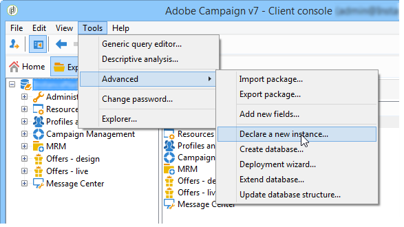

# 建立新執行個體{#creating-new-instances}

安裝Adobe Campaign並建立執行個體後，您就可以從主控台新增執行個體。 此建立模式可讓您在不存取主控台的情況下建立追蹤例項。

要執行此操作，請登入現有資料庫並套用下列步驟：

1. 宣告新執行個體

   移至&#x200B;**[!UICONTROL Tools > Advanced > Declare a new instance...]**&#x200B;以啟動助理。

   

   指定新執行個體的引數。 如需詳細資訊，請參閱[建立執行個體並登入](../../installation/using/creating-an-instance-and-logging-on.md)。
