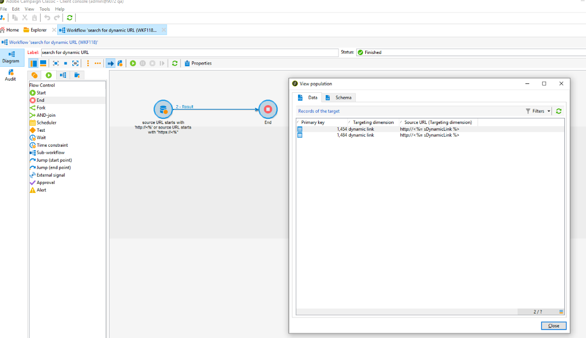

# 個人化與隱私 {#privacy}

本頁涵蓋URL個人化、URL簽名以及包含個人資訊的頁面的保護。

>[!NOTE]
>
>作為從Campaign v7轉變到v8的一部分，Campaign Classic檔案集已簡化並重新組織。 Campaign v8檔案集中現在提供常見功能。 若要進一步瞭解資料限制和隱私權要求，請參閱[Campaign v8檔案](https://experienceleague.adobe.com/zh-hant/docs/campaign/campaign-v8/privacy/security#data-restriction){target=_blank}。
>
>[](https://experienceleague.adobe.com/zh-hant/docs/campaign/campaign-v8/privacy/security#data-restriction){target="_blank"}

在Campaign Classic v7中，限制存取整個實體需要版本編號8770或更新版本。

## URL PERSONALIZATION {#url-personalization}

將個人化連結新增至您的內容時，請一律避免URL的主機名稱部分有任何個人化專案，以避免潛在的安全性缺口。 下列範例絕不應該用於所有URL屬性&lt;`a href="">`或``：

* `<%= url >`
* `https://<%= url >`
* `https://<%= domain >/path`
* `https://<%= sub-domain >.domain.tld/path`
* `https://sub.domain<%= main domain %>/path`

### 建議

若要驗證並確保您未使用上文，請透過[Campaign一般查詢編輯器](https://experienceleague.adobe.com/zh-hant/docs/campaign/campaign-v8/data/query/query-editor){target="_blank"} （Campaign v8檔案）對追蹤URL表格執行查詢，或在查詢活動中建立具有篩選條件的工作流程。 請參閱[Campaign v8檔案](https://experienceleague.adobe.com/docs/campaign/automation/workflows/wf-activities/targeting-activities/query.html?lang=zh-Hant){target="_blank"}。

範例：

1. 建立工作流程並新增&#x200B;**查詢**&#x200B;活動。 請參閱[Campaign v8檔案](https://experienceleague.adobe.com/docs/campaign/automation/workflows/wf-activities/targeting-activities/query.html?lang=zh-Hant){target="_blank"}。

1. 開啟&#x200B;**查詢**&#x200B;活動並在`nmsTrackingUrl`資料表上建立篩選器，如下所示：

   `source URL starts with http://<% or source URL starts with https://<%`

1. 執行工作流程並檢查是否有結果。

1. 若是如此，請開啟輸出轉變以檢視URL清單。

   


### URL簽章

為了提高安全性，我們引進了簽名機制，用於追蹤電子郵件中的連結。 它會從19.1.4 (9032@3a9dc9c)和20.2版本開始提供。 此功能預設為啟用。

>[!NOTE]
>
>按一下格式錯誤的已簽署URL時，會傳回此錯誤： `Requested URL '…' was not found.`

此外，您可以使用增強功能來停用先前組建中產生的URL。 此功能預設為停用。 您可以聯絡[客戶服務](https://helpx.adobe.com/tw/enterprise/admin-guide.html/enterprise/using/support-for-experience-cloud.ug.html)以啟用此功能。

如果您在19.1.4版本編號上執行，則可能會在使用追蹤連結或使用錨點標籤的推播通知傳送中遇到問題。 若是如此，建議您停用URL簽章。

身為行銷活動託管、受管理的Cloud Services或混合型客戶，您必須聯絡[客戶服務](https://helpx.adobe.com/tw/enterprise/using/support-for-experience-cloud.html)以停用URL簽章。

如果您在混合架構中執行Campaign，在啟用URL簽名之前，請確定已依下列方式升級代管的中間來源執行個體：

* 先使用內部部署行銷執行個體
* 然後升級至與內部部署行銷執行個體相同的版本或稍微更高的版本

否則，可能會發生以下部分問題：

* 在升級中間來源執行個體之前，會透過此執行個體傳送URL，而不使用簽名。
* 升級中間來源執行個體並在兩個執行個體上啟用URL簽名後，先前未經簽名而傳送的URL會遭到拒絕。 原因是行銷執行個體提供的追蹤檔案需要簽名。

若要停用先前組建中產生的URL，請同時在所有Campaign伺服器上執行下列步驟：

1. 在伺服器設定檔(`serverConf.xml`)中，將&#x200B;**blockRedirectForUnsignedTrackingLink**&#x200B;選項變更為&#x200B;**true**。
1. 重新啟動`nlserver`服務。
1. 在`tracking`伺服器上，重新啟動`web`伺服器（Debian上的apache2、CentOS/RedHat上的httpd、Windows上的IIS）。

若要啟用URL簽名，請同時在所有Campaign伺服器上執行下列步驟：

1. 在伺服器設定檔(`serverConf.xml`)中，將&#x200B;**signEmailLinks**&#x200B;選項變更為&#x200B;**true**。
1. 重新啟動&#x200B;**nlserver**&#x200B;服務。
1. 在`tracking`伺服器上，重新啟動`web`伺服器（Debian上的apache2、CentOS/RedHat上的httpd、Windows上的IIS）。

## 使用PI保護頁面

我們強烈建議內部部署客戶保護可能包含個人資訊(PI)的頁面，例如映象頁面、網頁應用程式等。

此程式的目標是防止這些頁面被編制索引，從而避免潛在的安全性風險。 以下是一些實用的文章：

* [https://developers.google.com/search/reference/robots_txt](https://developers.google.com/search/reference/robots_txt)
* [https://developers.google.com/search/reference/robots_meta_tag](https://developers.google.com/search/reference/robots_meta_tag)

若要保護您的頁面，請遵循下列步驟：

1. 在網頁伺服器（Apache或IIS）的根目錄新增`robots.txt`檔案。 以下是檔案的內容：

   ```sql
   # Make changes for all web spiders
   User-agent:
   *Disallow: /
   ```

   若為IIS，請參閱[此頁面](https://docs.microsoft.com/en-us/iis/extensions/iis-search-engine-optimization-toolkit/managing-robotstxt-and-sitemap-files)。

   若為Apache，您可以將檔案放在&#x200B;**/var/www/robots.txt** (Debian)中。

1. 有時新增&#x200B;**robots.txt**&#x200B;檔案的安全性不足。 例如，如果其他網站包含您頁面的連結，它可能會出現在搜尋結果中。

   除了&#x200B;**robots.txt**&#x200B;檔案，建議新增&#x200B;**X-Robots-Tag**&#x200B;標頭。 您可以在Apache或IIS以及&#x200B;**serverConf.xml**&#x200B;設定檔中執行此作業。

   如需詳細資訊，請參閱[本文章](https://developers.google.com/search/reference/robots_meta_tag)。
