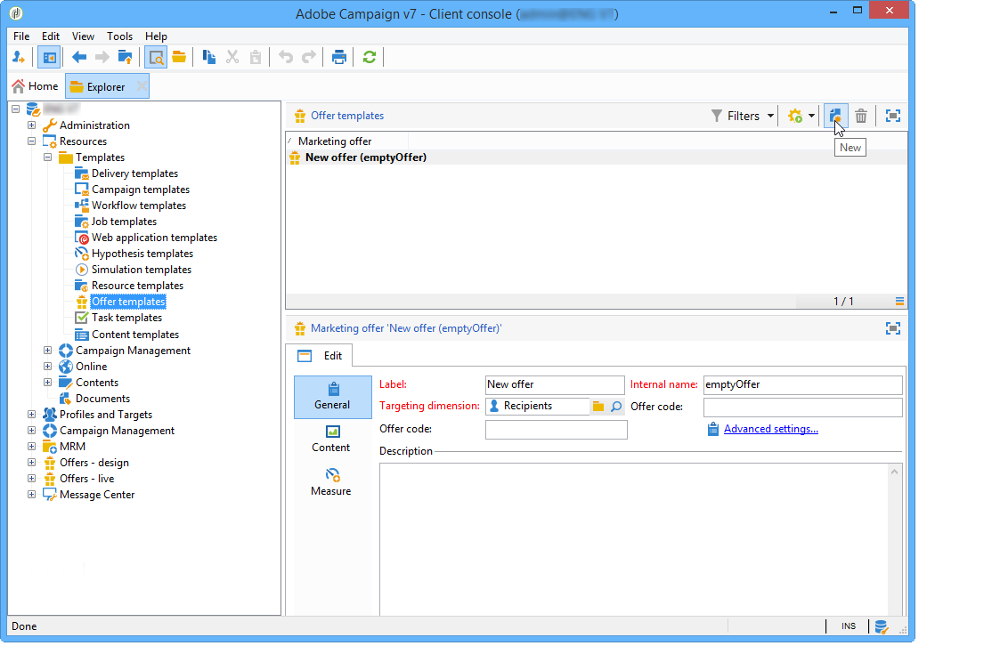
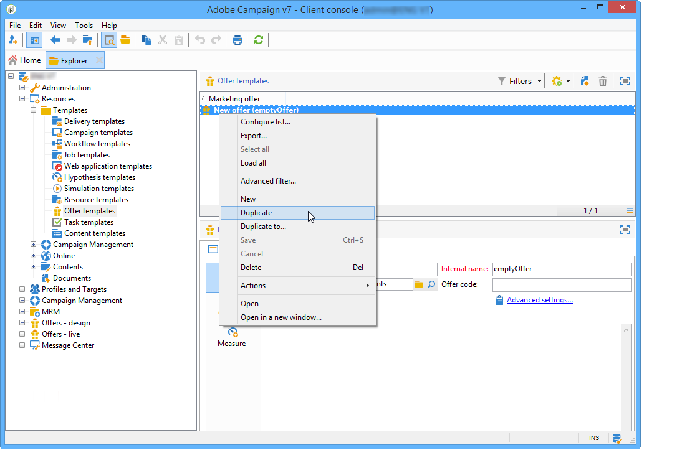
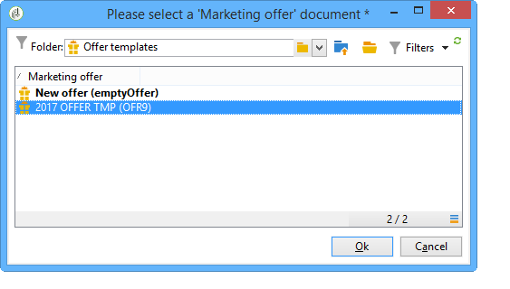

# 管理優惠方案範本{#managing-offer-templates}

Adobe Campaign中提供立即可用的優惠方案範本。 您可以在建立優惠方案、複製優惠方案或調整其設定以符合您的需求後，使用這些優惠方案。 您也可以建立自己的範本。 範本優惠方案儲存在資料夾&#x200B;**資源** > **範本** > **優惠方案範本**&#x200B;中。

## 建立優惠方案範本 {#creating-an-offer-template}

若要建立範本選件，請遵循下列步驟：

1. 移至&#x200B;**資源** > **範本** > **優惠方案範本**。
1. 按一下&#x200B;**新增**&#x200B;圖示。

   

1. 設定範本的方法為套用與一般優惠方案相同的程式，然後按一下[儲存] **儲存範本**。

## 複製現有範本 {#duplicate-an-existing-template}

若要複製優惠方案範本（無論是否為現成可用），請執行以下步驟：

1. 移至&#x200B;**資源>範本>優惠方案範本**。
1. 使用滑鼠，在您要複製的範本上按一下滑鼠右鍵，然後從下拉式功能表中選取&#x200B;**複製**。

   

1. 必要時，請設定您希望範本中顯示的設定，然後按一下[儲存] ****&#x200B;儲存範本。

建立優惠方案時，現在會提供此範本。

