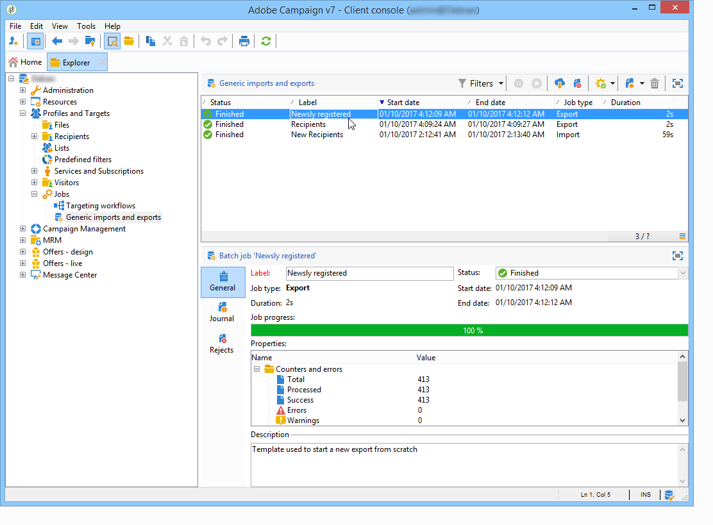
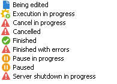

# 監視作業執行 {#monitoring-job-execution}

您可以直接從匯入/匯出作業清單追蹤匯入和匯出作業的執行。

* **[!UICONTROL Journal]**&#x200B;索引標籤可讓您檢視有關執行的記錄訊息。
* **[!UICONTROL Rejects]**&#x200B;索引標籤包含拒絕的記錄。 請參閱[本節](https://experienceleague.adobe.com/en/docs/campaign/campaign-v8/data/import#behavior-in-the-event-of-an-error){target="_blank"} （Campaign v8檔案）。

在&#x200B;**[!UICONTROL General]**&#x200B;索引標籤中，**[!UICONTROL Status]**&#x200B;欄位表示工作的目前狀態。

每個狀態都由一個特殊的圖示和標籤表示。 狀態及其圖示如下：

* **正在編輯**

  正在建立工作。

* **執行進行中**

  這項工作正在執行。

* **取消**

  按一下&#x200B;**[!UICONTROL Cancel]**&#x200B;按鈕：正在進行的工作已取消。

* **正在取消**

  取消命令已接收並且作業正在取消。

* **暫停進行中**

  按一下&#x200B;**[!UICONTROL Pause]**：工作已暫停。

* **已暫停**

  按一下&#x200B;**[!UICONTROL Pause]**：工作已暫停。 按一下&#x200B;**[!UICONTROL Start]**&#x200B;即可重新啟動。

* **已完成**

  執行作業已完成。

* **已完成，錯誤為**

  由於技術錯誤，該作業未執行。

* **伺服器正在關閉**

  正在進行的作業因 Adobe Campaign 伺服器已關閉而中斷。
