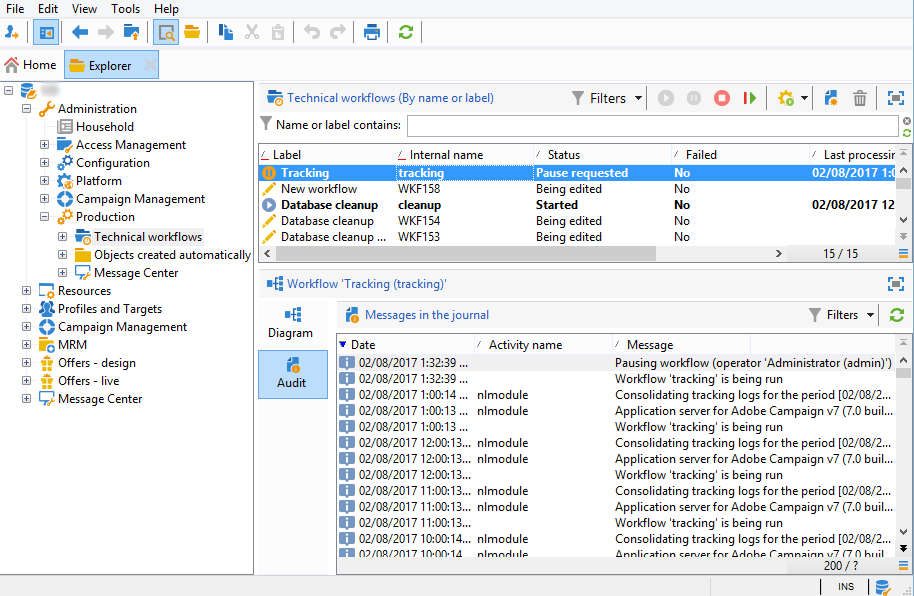

# 追蹤記錄檔問題{#tracking-logs-issues}

未轉送追蹤記錄的原因有好幾種。 建議您檢視下列資訊：

* **&#x200B;**&#x200B;追蹤&#x200B;**工作流程是否有錯誤？**

請參閱[Campaign v8檔案](https://experienceleague.adobe.com/docs/campaign/automation/workflows/monitoring-workflows/monitor-technical-workflows.html?lang=zh-Hant){target="_blank"}。

* **模組** trackinglogd **是否正在伺服器上執行？**

  請參閱[記錄檔](../../production/using/log-files.md)。

* **已進行變更嗎？**

  使用追蹤別名時，它們可能會觸發與伺服器的連線中斷。
