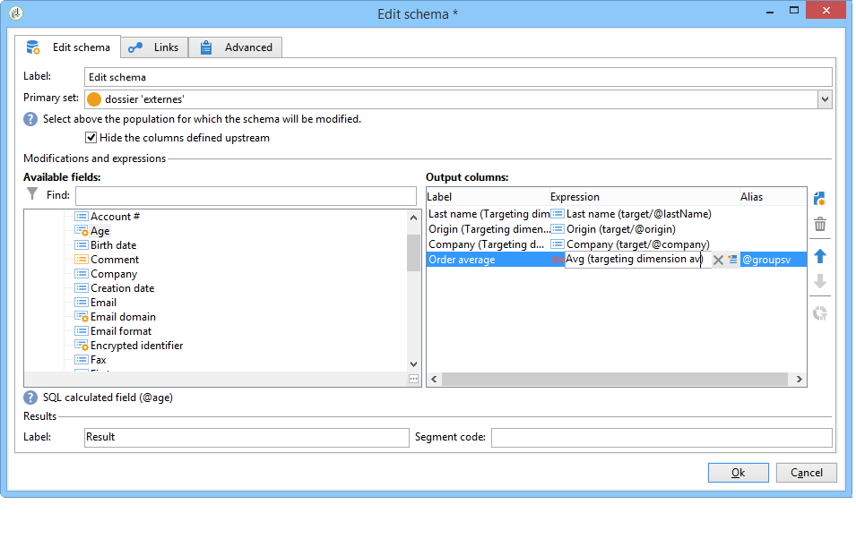
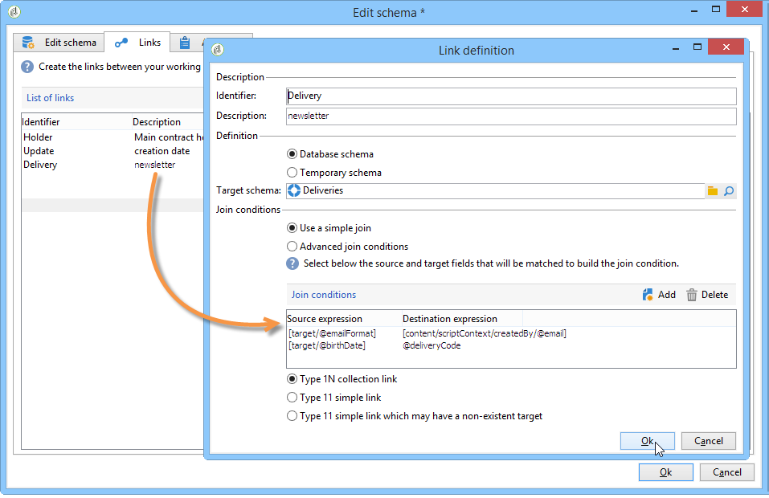

# 編輯結構描述{#edit-schema}

資料可以使用&#x200B;**[!UICONTROL Edit schema]**&#x200B;活動在工作流程中進行轉換、正規化及擴充（如有需要）。 它通常用於標準化資料結構：例如，您可以計算欄位或彙總的平均值，重新命名輸出欄或修改其內容。

此活動不會變更工作表中的資料，只會變更其結構描述，即資料的邏輯檢視。

您也可以透過&#x200B;**[!UICONTROL Links]**&#x200B;索引標籤建立與其他工作表的聯結。

下方可讓您設定加入條件的清單，也就是用來協調兩個表格資料的准則。
