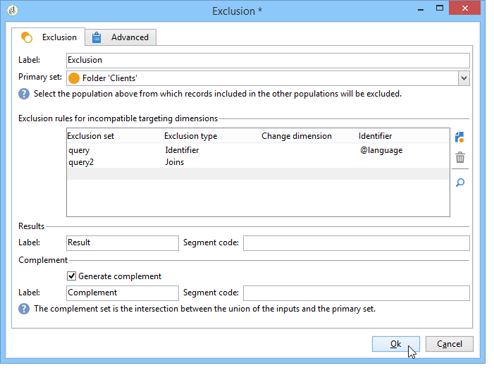
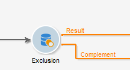
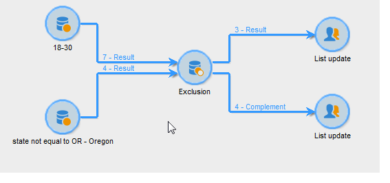

# 排除{#exclusion}

**排除**&#x200B;型別活動會根據擷取一或多個其他目標的主要目標建立目標。

若要設定此活動，請輸入其標籤並選取主要收件者集：主要集的母體可讓您建構結果。 將排除主要集和至少一個進入活動共用的設定檔。

>[!NOTE]
>
>如需設定及使用排除活動的詳細資訊，請參閱[排除母體（排除）](targeting-data.md#excluding-a-population--exclusion-)。

如果要利用剩餘母體，請核取&#x200B;**[!UICONTROL Generate complement]**&#x200B;選項。 補數將包含主要傳入母體減去傳出母體。 隨後會將其他輸出轉變新增到活動中，如下所示：

## 排除範例 {#exclusion-examples}

以下範例試圖編譯18至30歲之間的收件者清單，但不包括巴黎居民。

1. 在兩個查詢之後插入並開啟&#x200B;**[!UICONTROL Exclusion]** -type活動。 第一個查詢的目標是住在巴黎的收件者。 第二個查詢會鎖定年齡介於18至30歲之間的人。
1. 輸入主集。 這裡的主要集合是&#x200B;**18-30年的查詢**。 將從最終結果中排除屬於第二個集的元素。
1. 如果您要利用排除後剩餘的資料，請核取&#x200B;**[!UICONTROL Generate complement]**&#x200B;選項。 在此案例中，補充由18至30歲住在巴黎的收件者組成。
1. 核准排除設定，然後將更新清單活動插入至結果。 您也可以在必要時插入額外的清單更新至補充。
1. 執行工作流程。 在此範例中，結果是由年齡介於18至30歲的收件者組成，但住在巴黎的收件者會被排除並傳送至補充。

   

## 輸入引數 {#input-parameters}

* tableName
* 結構描述

每個傳入事件都必須指定由這些引數定義的目標。

## 輸出引數 {#output-parameters}

* tableName
* 結構描述
* recCount

這組三個值可識別排除所產生的目標。 **[!UICONTROL tableName]**&#x200B;是記錄目標識別碼的資料表名稱，**[!UICONTROL schema]**&#x200B;是母體的結構描述（通常是nms:recipient），而&#x200B;**[!UICONTROL recCount]**&#x200B;是資料表中的元素數目。

與補充關聯的轉變有相同的引數。
