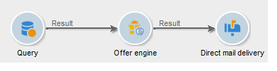
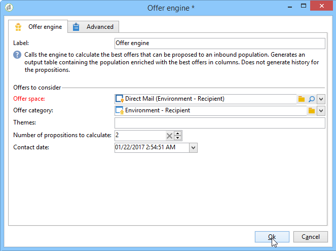

# 產品建議引擎{#offer-engine}

**[!UICONTROL Offer engine]**&#x200B;活動可讓您在傳遞前定義對優惠方案引擎的呼叫。

此活動的運作原則與引擎呼叫的擴充活動相同，也就是在傳送前，使用引擎計算的優惠擴充入站母體資料。

設定查詢之後（請參閱此[區段](query.md)）：

1. 新增並開啟&#x200B;**[!UICONTROL Offer engine]**&#x200B;活動。
1. 完成各種可用欄位，以指定呼叫優惠方案引擎引數（優惠方案空間、類別或主題、聯絡日期、要保留的優惠方案數量）。 引擎將根據這些引數自動計算要新增的選件。

   >[!CAUTION]
   >
   >如果您使用此活動，則只會儲存傳送中使用的優惠方案主張。

   

1. 然後，設定與您所選管道對應的傳送活動。 請參閱[跨通道傳遞](cross-channel-deliveries.md)。
