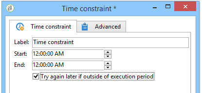

# 時間限制{#time-constraint}

**時間限制**&#x200B;活動可讓您延遲執行任務或捨棄該任務。

輸入活動的標籤，並指定工作流程任務必須暫停的時間範圍。

選取&#x200B;**[!UICONTROL Try again later if outside of execution period]**&#x200B;選項時，可讓您在執行時間範圍以外重新啟動工作。 如果您希望工作流程動作在暫停後永久放棄，請取消選取此選項。

